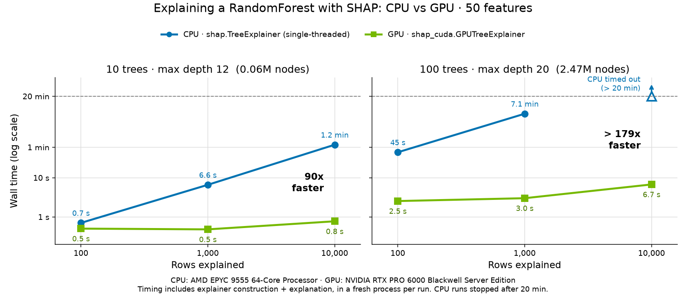

Calculating SHAP values can be computationally expensive, even with efficient algorithms like TreeSHAP. Our current TreeSHAP algorithm scales linearly with the number of observations, trees, and leaves, and quadratically with the depth of the trees.

Even though TreeSHAP is fast compared with other explainers, such as SamplingExplainer, it can still get slow for a large number of observations. GPUTreeExplainer has been around since 2020, but users had to build it from source. This is one of the pain points mentioned in the [Mindful Modeler blog post about maintaining SHAP](https://mindfulmodeler.substack.com/p/6-things-i-hate-about-shap-as-a-maintainer).

We are really happy to announce the release of [shap-cuda on PyPI](https://pypi.org/project/shap-cuda/) to speed up explanations for tree models through GPUTreeExplainer. On realistic workloads, this speeds up explanations by **90–180×**.

## What does this mean for users?

You can now explain tree models approximately **100× faster** than before, even on modest GPUs. The distributed binary removes the need to compile the GPU backend yourself, making GPU-accelerated explanations much easier to get started with.

Install it with:

```bash
pip install 'shap[cuda]'
```

This example trains a random forest on SHAP’s bundled diabetes dataset and explains the held-out observations using GPUTreeExplainer. Run it on a CUDA-capable GPU:

```python
# prerequisites: pip install 'shap[cuda]' scikit-learn

import shap
from sklearn.ensemble import RandomForestRegressor
from sklearn.model_selection import train_test_split

# Load a bundled example dataset (no download needed).
X, y = shap.datasets.diabetes()
X_train, X_test, y_train, _ = train_test_split(
    X, y, test_size=0.2, random_state=42
)

# Train a small tree model on the CPU.
model = RandomForestRegressor(
    n_estimators=100, max_depth=6, random_state=42
).fit(X_train, y_train)

# Calculate SHAP values on the GPU for held-out observations.
explainer = shap.GPUTreeExplainer(
    model, feature_perturbation="tree_path_dependent"
)
shap_values = explainer.shap_values(X_test)
print(shap_values.shape)  # (89, 10)
```



*Explanation time versus the number of rows, comparing single-threaded TreeExplainer on an AMD EPYC 9555 CPU with GPUTreeExplainer on an NVIDIA RTX PRO 6000 Blackwell Server Edition GPU. Timing includes explainer construction and explanation; CPU runs were stopped after 20 minutes.*

Just think of getting a two-hour job down to a minute, all thanks to the amazing parallelization provided by CUDA.

## How we did it

We moved the CUDA implementation into a separate, optional package, `shap-cuda`, under the repository’s `backends/` directory. This lets us build and distribute the GPU backend separately from the core SHAP package. Users who want GPU acceleration can install it with `pip install 'shap[cuda]'`, while the standard installation does not depend on the CUDA backend.

To connect the two packages, we use Python packaging **entry points**. The CUDA package registers its explainer in the `shap.tree_backends` group, and SHAP discovers and loads it when users access `shap.GPUTreeExplainer`. This preserves the familiar API and gives other accelerator backends a place to plug in in the future, without requiring users to import a backend-specific package.

We also set up on-demand GPU testing on AWS. The workflow starts an EC2 instance with a GPU, checks out the repository, builds SHAP and the CUDA backend, and runs the GPU-related tests.

A cleanup job shuts down the instance even if the tests fail. Test datasets are downloaded on a CPU runner beforehand, so the GPU runner spends its time running tests rather than waiting for downloads.

Our release workflow is designed to **test the exact wheel that will be published**. CUDA compilation runs on a CPU runner with the CUDA toolkit; a physical GPU is only needed to execute the tests. The built wheel is then passed to the AWS GPU runner, and publication is gated on those tests passing. This checks the binary users will install, rather than rebuilding a different copy for testing.

We evaluated different options and learned from [how scikit-learn approached GPU testing](https://betatim.github.io/posts/github-action-with-gpu/).

Like scikit-learn, we run GPU tests selectively using a maintainer-applied `CUDA CI` label. We chose on-demand AWS runners to reduce compute costs, taking responsibility for provisioning and cleanup ourselves.

For T4 GPUs, AWS is roughly **5× cheaper in base compute costs**: a Linux `g4dn.xlarge` in US East (Northern Virginia) is listed at about [$0.526 per hour](https://aws.amazon.com/blogs/machine-learning/run-inference-at-scale-for-openfold-a-pytorch-based-protein-folding-ml-model-using-amazon-eks/), compared with [$3.12 per hour for GitHub’s Linux GPU runner](https://docs.github.com/en/billing/reference/actions-runner-pricing). Startup and setup time, storage, and networking add to the AWS bill, but we still expect AWS to be several times cheaper overall.

## Thank you

Special thanks to our open source home at the **German Center for Open Source AI**, which provides fiscal hosting for the GPU runners, and to the **NVIDIA team** for providing the funds, testing the implementation on their hardware, and helping with the engineering to make this possible.
